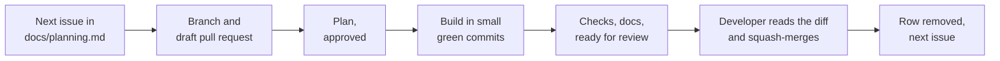

# Workflow

The life of an issue, from the queue to production. In Claude Code, the skills in
`.claude/skills/` run these steps; this guide is the same process for a person.

## 1. Start (`/start-issue <number>`)

1. Pick the first issue in `docs/planning.md` whose `Blocked by` issues are all closed.
2. From an up-to-date `main`, create `<type>/<REQ-ID>-<short-name>`, for example
   `feat/FR-SHOP-003-realtime-list` (type: feat, fix, refactor, test, docs or chore).
3. Open a draft pull request at once, on an empty commit, so CI runs on every push. Its title is a
   Conventional Commit with the requirement ID; its body is `Closes #<issue>`.
4. Read the requirement in `docs/srs.md`, its screen in `docs/design-system/screens/` and the
   related architecture, and write a plan: files by layer, tests first, privacy and accessibility
   risks. Code starts once the plan is approved.

## 2. Build

- Domain and services test-first. Commit each coherent, green step with a Conventional Commit:
  `feat(shopping): live updates (FR-SHOP-003)`.
- Keep the branch current by merging `main`, never rebasing: `git fetch origin`,
  `git merge origin/main`.
- A migration merges first, in its own pull request (`migrations.md`). Each earlier part of a
  split issue has its own branch from `main` and `Part of #<issue>` in its body, never `Closes`
  (`/start-partial`, `/ship-partial`).

## 3. Ship (`/ship`)

1. Merge `main`, then `pnpm check` (and `pnpm db:test` if `supabase/` changed).
2. Go through the Definition of done in `AGENTS.md`: acceptance criteria tested, keyboard and both
   themes checked, `docs/features/` and guides updated, screenshots taken (`screenshots.md`).
3. Remove the issue's row from `docs/planning.md`.
4. Fill the pull request from `.github/pull_request_template.md` and mark it ready.

## 4. Merge

The developer reads the diff and squash-merges; the pull request title becomes the commit on
`main`. Then Vercel deploys and, for a migration, `migrate.yml` runs (`deployment.md`).
