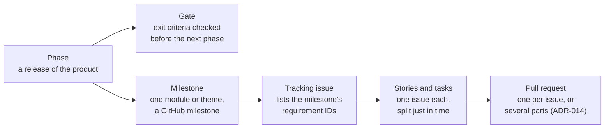

# Roadmap

How HØEM gets from today to the release and beyond. GitHub holds the milestones and issues;
`docs/planning.md` holds the order of the open issues; this file holds the big picture: phases,
gates, milestones and the work that still has to become issues.

> **Draft.** The sections marked _To define_ are being worked out with the developer. Nothing in
> "Work to turn into issues" exists on GitHub yet.

## How the work is organised

- **Phase:** a version of the product with a clear goal. Phase 1 is the MVP; later phases add the
  requirements in SRS §4.
- **Gate:** the criteria a phase must meet before the next one starts (SRS §8).
- **Milestone:** a GitHub milestone (`M0`, `M1a`…). It starts with a tracking issue (`chore: plan
and track Mn …`) that lists every requirement it covers, and is split into stories when the
  previous milestone is close to done (rolling-wave planning). It ends with its documentation
  review issue.
- **Issue:** a story (`type:feature`), task (`type:chore`), bug or docs issue, with priority
  (MoSCoW) and `Blocked by` / `Blocks` lines. Its place in the queue is in `docs/planning.md`.

## Phases and gates

_To define:_ the SRS roadmap had 4 phases and 3 gates in a diagram that was lost when the document
was exported. What is still known:

| Phase | Goal                                        | Requirements                                                        | Ends at                 |
| ----- | ------------------------------------------- | ------------------------------------------------------------------- | ----------------------- |
| 1     | MVP: the core modules, released as `v1.0.0` | SRS §3 and §5 (Must, then Should)                                   | Gate B: portfolio-ready |
| 2     | _To define_                                 | SRS §4, phase 2 (savings, subscriptions, shopping history, Spanish) | _To define_             |
| 3     | _To define_                                 | SRS §4, phase 3 (chores, habits, offline, AI assistant, receipts)   | _To define_             |
| 4     | _To define_                                 | _To define_                                                         | —                       |

Questions to answer together:

1. What do Gate A and Gate C stand for, and where is Gate A (inside phase 1, for example after
   M1b)?
2. What are the exit criteria of each gate (for example: every Must closed, accessibility audit
   passed, Lighthouse ≥ 90, no open bug with `priority:must`)?
3. What is phase 4?

## Phase 1 milestones

Snapshot of 2026-11-04. Open and closed counts come from GitHub and change every day; this table
records goals and order, not progress.

| Milestone                        | Goal                                                                               | Tracking issue | State                                     |
| -------------------------------- | ---------------------------------------------------------------------------------- | -------------- | ----------------------------------------- |
| M0 Walking skeleton              | Next.js on Vercel, Supabase EU, e-mail sign-in, design tokens, next-intl, Resend   | —              | Done (no open issues; milestone to close) |
| M1a Shell & profile              | Household data model and RLS, household types, app shell, profile, sign-in options | —              | In progress                               |
| M1b Members, invitations & setup | Members and roles, invitations, minors, family splitting, other households, setup  | —              | In progress                               |
| M2 Shopping                      | Shared and private shopping lists with live updates (FR-SHOP)                      | #35            | Not split yet                             |
| M3 Meals & recipes               | Recipes, meal plan, recipe-to-shopping-list (FR-MEAL, FR-INT)                      | #36            | Not split yet                             |
| M4 Expenses & budgets            | Shared and private expenses, splits, balances, budgets (FR-EXP)                    | #37            | Not split yet                             |
| M5 Planner & notifications       | Notes, reminders, PWA and push notifications (FR-NOTE, FR-NOTIF)                   | #38            | Not split yet                             |
| M6 Dashboard & demo              | Daily dashboard and the no-account demo (FR-DASH, FR-DEMO)                         | #39            | Not split yet                             |
| M7 MVP release v1.0.0            | Accessibility audit, performance, legal pages, security review; tag `v1.0.0`       | #40            | Not split yet                             |

_To define per milestone:_ its exit criteria (beyond "every issue closed"), the requirement IDs it
proves, and a rough size, so a milestone fits the 6–8 weeks per phase of SRS §2.4.

## Work to turn into issues

Found while reviewing the repository organisation (November 2026). Each line becomes an issue once
we agree on its milestone and priority; then it is placed in `docs/planning.md`.

| Work                                                                                               | Source                        | Proposed milestone | Notes                                                    |
| -------------------------------------------------------------------------------------------------- | ----------------------------- | ------------------ | -------------------------------------------------------- |
| Close the M0 milestone on GitHub                                                                   | GitHub                        | M0                 | A click, not an issue                                    |
| ESLint rule that fails when a layer imports upwards                                                | architecture §4.2             | _To define_        | Depends on the decision about `eslint-plugin-boundaries` |
| Observability: Sentry, structured logs, Vercel Analytics                                           | architecture §9.3             | M7                 | Before real users                                        |
| OpenAPI document generated from the Zod schemas, served at `/api/v1/openapi.json`, with a CI check | architecture §5.4, §9.2 row 4 | _To define_        | Cheaper while the API is small                           |
| Lighthouse CI on the preview URL                                                                   | architecture §9.2 row 6       | M7                 | NFR-PERF-002                                             |
| Secret scanning and dependency audit in CI                                                         | architecture §9.2 row 7       | _To define_        | GitHub secret scanning may cover half of it              |
| Decide on Radix UI / shadcn, Framer Motion and Storybook, listed in the SRS stack but not used     | SRS §7.1                      | _To define_        | Update SRS §7.1 with the decision                        |
| Feature pages for `auth`, `home` and `shell`                                                       | `docs/features/`              | M1 docs review #71 | Could join #71 instead of a new issue                    |
| Move setup, deployment and runbooks into `docs/guides/`                                            | `docs/guides/README.md`       | M1 docs review #71 | Being done in this branch                                |
| Release process: changelog and tags                                                                | Organisation review, point 8  | M7                 | Pending decision                                         |
| Documentation review issue for each of M2–M7                                                       | `AGENTS.md`, Planning         | M2–M7              | Created when each tracking issue is split                |
