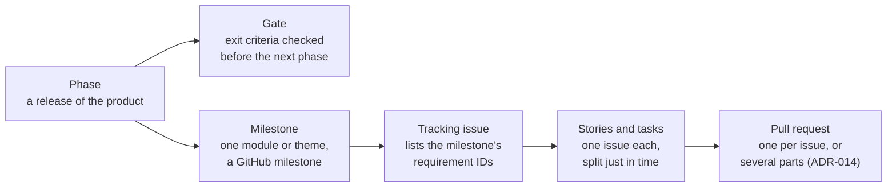
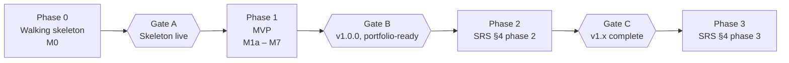

# Roadmap

How HØEM gets from today to the release and beyond. GitHub holds the milestones and issues;
`docs/planning.md` holds the order of the open issues; this file holds the big picture: phases,
gates, milestones and the work that still has to become issues.

> **Draft.** The phases and gates are a proposal, and the sections marked _To define_ are being
> worked out with the developer. Nothing in "Work to turn into issues" exists on GitHub yet.

## How the work is organised

- **Phase:** a version of the product with a clear goal. Phase 1 is the MVP; later phases add the
  requirements in SRS §4.
- **Gate:** the criteria a phase must meet before the next one starts (SRS §8).
- **Milestone:** a GitHub milestone (`M0`, `M1a`…). It starts with a tracking issue (`chore: plan
and track Mn …`) that lists every requirement it covers, and is split into stories when the
  previous milestone is close to done (rolling-wave planning). It ends with its documentation
  review issue.
- **Issue:** a story (`type:feature`), task (`type:chore`), bug or docs issue, with priority
  (MoSCoW) and `Blocked by` / `Blocks` lines. Its place in the queue is in `docs/planning.md`.

## Phases and gates

**Proposed** (November 2026), rebuilt after the original SRS diagram was lost: 4 phases and
3 gates, keeping the phase numbers of SRS §4. A phase starts only when the gate before it is
passed (SRS §8).

| Phase | Goal                                                                        | Milestones | Ends at |
| ----- | --------------------------------------------------------------------------- | ---------- | ------- |
| 0     | Prove the stack end to end: deploy, database, sign-in, tokens, CI           | M0         | Gate A  |
| 1     | MVP: every Must of SRS §3 and §5, released as `v1.0.0`                      | M1a – M7   | Gate B  |
| 2     | Savings goals, subscriptions, shopping history, Spanish (SRS §4, phase 2)   | M8 onwards | Gate C  |
| 3     | Chores, habits, offline reading, meal assistant, receipts (SRS §4, phase 3) | To plan    | —       |

Phase 2 and 3 milestones are planned at Gate B and Gate C, after their requirements are detailed in
the SRS (SRS §4).

### Gate A: skeleton live (passed)

- [x] The app is deployed at https://hoemapp.com from `main`, with a preview per pull request.
- [x] Supabase staging and production run in the EU, and migrations reach them through
      `migrate.yml` (ADR-013, ADR-014).
- [x] Sign-up and sign-in by e-mail work, with e-mails sent by Resend.
- [x] CI runs lint, typecheck, unit tests, database tests and end-to-end tests with axe-core.
- [x] Design tokens and next-intl are in place.

### Gate B: v1.0.0, portfolio-ready

- [ ] Every `Must` requirement of SRS §3 and §5 is closed and proved by a test named with its ID.
      `Should` requirements left out are listed in the release notes.
- [ ] No open bug with `priority:must`.
- [ ] Accessibility: axe-core passes in both themes, and a manual keyboard and screen-reader pass
      on every screen finds no WCAG 2.2 AA failure (NFR-A11Y).
- [ ] Performance: Lighthouse ≥ 90 on the main screens on mobile (NFR-PERF-002).
- [ ] Security: a review against the OWASP ASVS checklist, rate limits on, no high-severity
      vulnerability in dependencies (NFR-SEC).
- [ ] Legal: privacy policy and terms published (NFR-LEG-002), data export and deletion work
      (NFR-LEG-003).
- [ ] The demo opens without an account in under a minute (FR-DEMO).
- [ ] Error tracking and logs are in place (architecture §9.3).
- [ ] Every milestone's documentation review is closed, and `v1.0.0` is tagged.

### Gate C: v1.x complete

- [ ] Every `Must` of phase 2 is closed, with the same quality bar as Gate B (accessibility,
      performance, security).
- [ ] The interface is fully translated into Spanish (FR-I18N-001).

## Phase 1 milestones

Snapshot of 2026-11-04. Open and closed counts come from GitHub and change every day; this table
records goals and order, not progress.

| Milestone                        | Goal                                                                               | Tracking issue | State                                     |
| -------------------------------- | ---------------------------------------------------------------------------------- | -------------- | ----------------------------------------- |
| M0 Walking skeleton              | Next.js on Vercel, Supabase EU, e-mail sign-in, design tokens, next-intl, Resend   | —              | Done (no open issues; milestone to close) |
| M1a Shell & profile              | Household data model and RLS, household types, app shell, profile, sign-in options | —              | In progress                               |
| M1b Members, invitations & setup | Members and roles, invitations, minors, family splitting, other households, setup  | —              | In progress                               |
| M2 Shopping                      | Shared and private shopping lists with live updates (FR-SHOP)                      | #35            | Not split yet                             |
| M3 Meals & recipes               | Recipes, meal plan, recipe-to-shopping-list (FR-MEAL, FR-INT)                      | #36            | Not split yet                             |
| M4 Expenses & budgets            | Shared and private expenses, splits, balances, budgets (FR-EXP)                    | #37            | Not split yet                             |
| M5 Planner & notifications       | Notes, reminders, PWA and push notifications (FR-NOTE, FR-NOTIF)                   | #38            | Not split yet                             |
| M6 Dashboard & demo              | Daily dashboard and the no-account demo (FR-DASH, FR-DEMO)                         | #39            | Not split yet                             |
| M7 MVP release v1.0.0            | Accessibility audit, performance, legal pages, security review; tag `v1.0.0`       | #40            | Not split yet                             |

_To define per milestone:_ its exit criteria (beyond "every issue closed"), the requirement IDs it
proves, and a rough size, so a milestone fits the 6–8 weeks per phase of SRS §2.4.

## Work to turn into issues

Found while reviewing the repository organisation (November 2026). Each line becomes an issue once
we agree on its milestone and priority; then it is placed in `docs/planning.md`.

| Work                                                                                               | Source                        | Proposed milestone | Notes                                       |
| -------------------------------------------------------------------------------------------------- | ----------------------------- | ------------------ | ------------------------------------------- |
| Close the M0 milestone on GitHub                                                                   | GitHub                        | M0                 | A click, not an issue                       |
| Observability: Sentry, structured logs, Vercel Analytics                                           | architecture §9.3             | M7                 | Before real users                           |
| OpenAPI document generated from the Zod schemas, served at `/api/v1/openapi.json`, with a CI check | architecture §5.4, §9.2 row 4 | _To define_        | Cheaper while the API is small              |
| Lighthouse CI on the preview URL                                                                   | architecture §9.2 row 6       | M7                 | NFR-PERF-002                                |
| Secret scanning and dependency audit in CI                                                         | architecture §9.2 row 7       | _To define_        | GitHub secret scanning may cover half of it |
| Feature pages for `auth`, `home` and `shell`                                                       | `docs/features/`              | M1 docs review #71 | Could join #71 instead of a new issue       |
| Release process: changelog and tags                                                                | Organisation review, point 8  | M7                 | Pending decision                            |
| Documentation review issue for each of M2–M7                                                       | `AGENTS.md`, Planning         | M2–M7              | Created when each tracking issue is split   |
